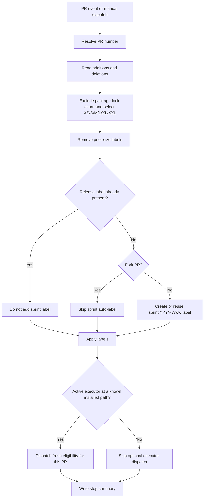

# PR Size and Sprint Labeler Workflow

Workflow file: `.github/workflows/pr-size-labeler.yml`

## Purpose

Applies deterministic size labels and ensures a release-planning label exists on PRs.

The size label measures line churn only. Batch decomposition is a separate
merge-eligibility rule: batches over 15 files or 300 additions plus deletions
must split or obtain the qualified mechanical exception documented in the PR
template. Cohesive individual features are not capped by that batch rule, and a
size label never authorizes an exception. The existing XXL qualified-human gate
is unchanged.

## Flow

## Entrance

| Item | Value |
|---|---|
| Trigger | `pull_request_target` (`opened`, `synchronize`, `reopened`, `ready_for_review`) |
| Manual trigger | `workflow_dispatch` with `pr_number` |
| Concurrency | Workflow name + PR number, manual `inputs.pr_number`, or ref; `cancel-in-progress: false` finishes label reconciliation |
| Permissions | `actions: write`, `contents: read`, `issues: write`, `pull-requests: write` |

## Exit

| Path | Exit condition |
|---|---|
| Pass | Size label reconciled and optional sprint label logic completed |
| No-op | PR already has release label; sprint auto-label skipped |
| Fail | PR number cannot be resolved, label API calls fail, or active executor dispatch fails |

After applying labels, the workflow requests fresh eligibility for the single
labeled PR on the default branch. It recognizes only active executors at
`.github/workflows/pr-auto-merge-executor.yml` or
`.github/workflows/basecoat-pr-auto-merge-executor.yml`, not display names.
Absent or disabled executors are skipped; actual dispatch errors fail the run.
This notification does not approve, merge, or bypass any executor gate.

## Schedule

No `schedule` trigger.

## Inputs

| Input | Type | Required | Purpose |
|---|---|---|---|
| `pr_number` | number | Yes for manual dispatch | Target PR to label |

## Variables and secrets

| Type | Name | Used by |
|---|---|---|
| Env | `PR_NUMBER_INPUT` | Manual dispatch PR resolution |

No external secrets are required.

## Label outputs

| Label family | Behavior |
|---|---|
| `size:*` | Exactly one active size label based on line churn |
| `sprint:*` / `wave:*` | If one already exists, no new sprint label is added |
| `sprint:YYYY-Www` | Auto-created and applied only when missing release label and PR is not from a fork |
